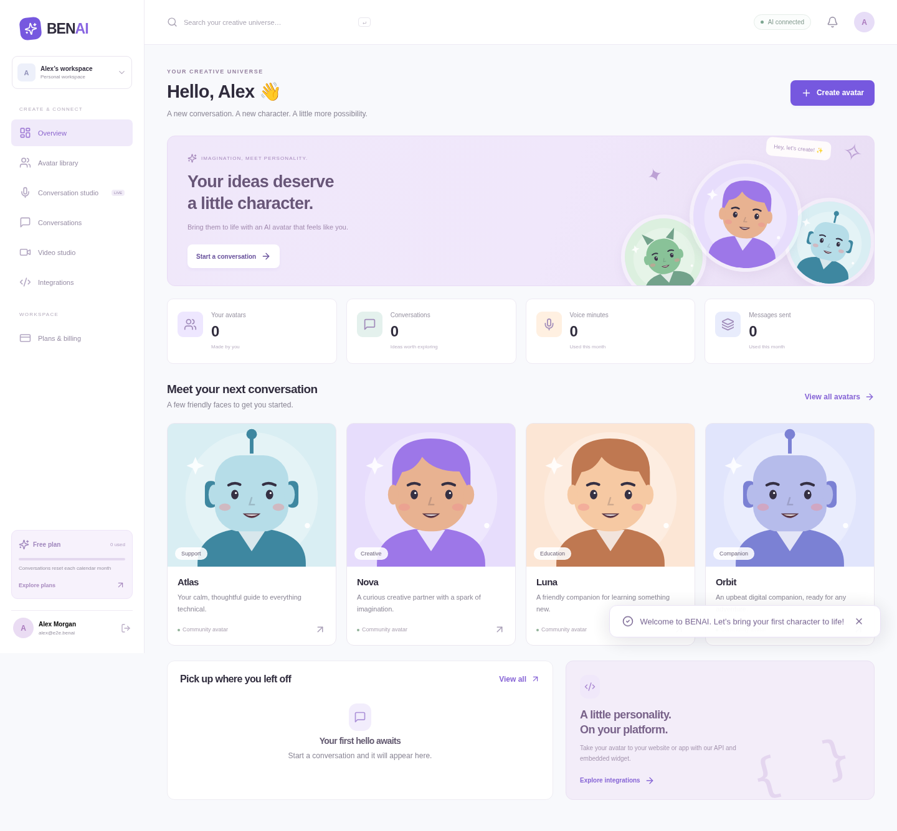

# BENAI Studio

An original full-stack platform for animated AI characters, inspired by the capabilities of Mascotbot. Includes a real backend, customer accounts, an admin workspace, free/paid plan entitlements, local AI, voice conversations, video export, customer API keys, and embeddable assistants.



## Run it without paid AI subscriptions

Requirements: **Node.js 24+, Python 3.12, FFmpeg, curl, unzip**, Linux x86-64, approximately 5 GB of disk for models/runtime, and at least 8 GB available RAM. This environment was tested with a CPU; a GPU is not required for the included chat and speech models.

```bash
npm ci
cp .env.example .env
npm run setup:local
```

`setup:local` downloads pinned, checksum-verified official artifacts for Qwen2.5-0.5B-Instruct, Piper LJSpeech, Whisper tiny.en, and Segmind Tiny-SD. Runtime files are outside the checkout at `/workspace/benai-runtime`. For a different machine, set `BENAI_RUNTIME_DIR=/your/absolute/path` for both setup and startup.

In one terminal:

```bash
npm run services:local
```

In another:

```bash
npm run build
npm start
```

Open the app on port 3001. For frontend development, use `npm run dev` and Vite on port 5173. Set `APP_URL` to the origin you actually use, including the port. `LOCAL_AI_URL=http://127.0.0.1:8081/v1` and `LOCAL_SPEECH_URL=http://127.0.0.1:8082` connect the free local services. `LOCAL_IMAGE_URL=http://127.0.0.1:8083` connects the included diffusion image server. Set `BENAI_SKIP_IMAGES=1` for setup/startup to omit that larger component. Set `DEMO_MODE=false` for genuine AI replies; `true` explicitly permits labeled sample responses only when no AI provider is configured.

No model API key is needed for the default local workflow. Hosting still uses compute and storage; this is not a promise of unlimited free production hosting.

## Your administrator account

Register your own account through the website, then run:

```bash
npm run admin:create -- --email=your@email.com
```

This promotes that account to administrator. It does not create a default password. Alternatively, set `ADMIN_EMAIL` and a secure `ADMIN_PASSWORD` of at least 12 characters before first startup to bootstrap a new administrator. Bootstrap never changes an existing account’s password or silently promotes an existing customer.

Administrators can publish shared avatars, edit personalities and appearance, grant customer plans without collecting payment, manage customer roles, and inspect audit records. Customers cannot access other customers’ private avatars, conversations, API keys, or videos.


## Included features

| Capability              | Implementation                                                                                                                              |
| ----------------------- | ------------------------------------------------------------------------------------------------------------------------------------------- |
| Customer authentication | Email/password, scrypt hashes, hashed expiring sessions, secure production cookies, CSRF and origin checks, rate limits                     |
| Avatar library          | Six original SVG characters; private/custom avatars; image upload; glasses, hair/suit colors, gestures, personality and voice controls      |
| Avatar creation         | Free local Tiny-SD AI images; procedural illustration fallback; optional external diffusion or OpenAI image generation                      |
| AI conversations        | Local Qwen through llama.cpp; persistent history; optional OpenAI-compatible paid chat                                                      |
| Voice                   | Local Piper speech; local Whisper transcription; microphone messages and hands-free voice activity detection                                |
| Animation               | Audio-level-driven 2D mouth animation and simple gestures; JavaScript SDK accepts audio or MediaStream input                                |
| Video                   | Private downloadable MP4 with local voice and animated portrait; persisted jobs, recovery on restart; optional HeyGen adapter               |
| Plans                   | Free, Creator, Business; monthly message, voice, image and video quotas; administrator grants; optional Stripe Checkout and customer portal |
| Integrations            | Hashed/revocable server-side API keys; scoped/revocable iframe chat widgets with shared message/voice quotas                                |
| Text storage            | SQLite default; native MongoDB/Atlas collections when `MONGODB_URI` is set                                                                  |
| Video storage           | Private local files default; Cloudflare R2 when its environment variables are set; short-lived signed downloads                             |

The model is deliberately small so it runs on a CPU. Replace its GGUF and use the same OpenAI-compatible API for stronger open-weight models. Local voice recognition is English; the five voice styles adjust one included Piper voice’s speaking rate. Custom raster images are animated portraits; only the built-in SVG rigs have adjustable mouths. Video export runs at 12 fps. Live SDK animation follows `requestAnimationFrame` and the device refresh rate; **120 fps, phoneme-accurate visemes, and Mascotbot performance parity have not been established**.

## MongoDB Atlas

Set `MONGODB_URI` securely to your Atlas connection string and optionally `MONGODB_DB=benai`. Atlas becomes the primary database; the app does not mirror into SQLite. TLS remains enabled through the native MongoDB driver. Allow the server’s IP in Atlas and allow the cluster’s required network destinations. Native MongoDB credentials must be real server environment values, not HTTP-proxy placeholders.

SQLite and MongoDB are separate backends: changing `MONGODB_URI` does **not** migrate existing local accounts. Start with your chosen backend before onboarding customers, or perform a reviewed migration. Atlas credentials/connectivity have not been tested for your account. The native adapter is tested against a real local MongoDB replica set, including message transactions, persistent sessions, and concurrent quotas.

## Cloudflare R2

Create a **private** bucket and set `R2_ENDPOINT`, `R2_BUCKET`, `R2_ACCESS_KEY_ID`, and `R2_SECRET_ACCESS_KEY`. Use the account’s HTTPS S3 endpoint. On completed local renders, BENAI uploads the MP4 using the S3 SDK and stores the object key in the selected database. Authorized users receive a signed download URL that expires after five minutes. Local video files are retained until you apply your own storage retention policy. User avatar uploads remain on the application volume; back up that volume too.

Do not put credentials in chat, source control, browser code, or the public SDK. R2 credentials/signing require real server environment values, not proxy placeholders. Object storage API behavior is covered by a local S3 fixture; your R2 account still needs a connection test after configuration.

## Customer subscriptions

The free tier runs immediately. Admins can grant Creator/Business access without a payment provider. To charge customers, configure the optional Stripe values in `.env.example`, create recurring USD prices matching your intended pricing, and configure a webhook to `/api/billing/webhook` for `customer.subscription.created`, `updated`, and `deleted`. Enable the Stripe customer portal in the Stripe dashboard.

Only signature-verified webhooks reconcile paid plans. Reconciliation reads the customer’s current subscription state so reordered cancellation events do not downgrade a newer subscription. No purchase is simulated when billing is absent. Stripe account setup, test checkout, and public webhook delivery need your account and deployment; they have not been performed here. Stripe has payment-processing fees even without a monthly platform subscription.

## Optional image/video providers

`LOCAL_IMAGE_URL` supports the AUTOMATIC1111 `/sdapi/v1/txt2img` API. You must run that service with your licensed model and suitable hardware. When the local image service is running, avatar creation uses real Tiny-SD diffusion. With no image provider configured, the illustration fallback is procedural, **not diffusion AI**. Set `AI_PROVIDER_KEY` (or `OPENAI_API_KEY`) to use OpenAI chat, speech, and image APIs instead. These incur provider charges. Optional remote realtime tokens are issued only for paid-tier users and expire quickly; client duration limits are advisory, so do not enable this paid endpoint for untrusted clients without a server-side spending policy.

For remote HeyGen video, configure `HEYGEN_API_KEY`, `HEYGEN_VOICE_ID`, and the character’s provider avatar ID. Uploaded portraits are not automatically registered as HeyGen avatars. Local speech/video takes precedence when configured.

## APIs and SDK

See [API documentation](docs/API.md) and [SDK examples](docs/SDK.md). The API key is shown only on creation. Keep it on your customer’s server. Never expose a full account API key in a website widget.

## Validation

```bash
npm test                    # Authentication, ownership, quotas, keys, widgets, billing signatures/state
npm run build               # Production frontend
npm run test:e2e            # Start local AI/speech first; Chromium must be installed
npm run test:cloud           # Local Mongo replica-set + S3 storage tests
npm run test:models          # Real AI image generation; start local services first
```

Browser tests create isolated fixture accounts and verify actual local model replies, TTS/transcription, avatar editing, API requests, widgets, video rendering, and private downloads. Tests do not require paid services. Set `BENAI_TEST_AUDIO=/absolute/path/to/speech.wav` when running browser tests to also exercise hands-free microphone capture with a Chromium audio fixture. Test databases are isolated from your `.data` directory. Cloud tests download an official MongoDB test binary on first run and verify its published checksum.

## Deployment

See [deployment instructions](docs/DEPLOYMENT.md). Keep the model and speech servers bound to loopback. Use HTTPS for microphone access outside localhost and for production session cookies. Persist `.data`, your runtime/model directories, and your MongoDB database/R2 bucket as appropriate. Set `NODE_ENV=production`, `APP_URL=https://your-domain`, and `DEMO_MODE=false`. Set `TRUST_PROXY=1` only behind exactly one trusted reverse proxy.

This repository supplies a working development product and deployment instructions. No domain or public hosting has been provisioned. Email verification, self-service password reset, production monitoring, enterprise SSO, distributed job processing, and hardware performance guarantees are not included. Administrator-assisted recovery can be added as a separate provider-backed workflow before a public launch requiring those capabilities.

## Licensing

BENAI code and original SVG characters: MIT. Included model licenses and speech software have their own terms; see [model attribution](docs/MODELS.md). Mascotbot trademarks, source code, and assets are not included.
