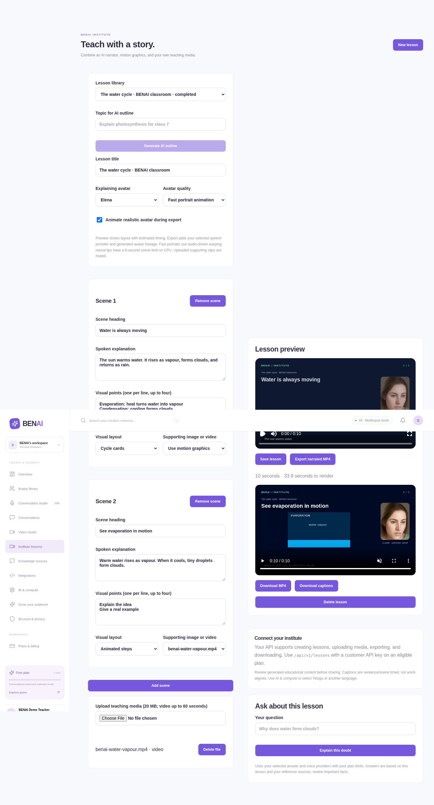

# BENAI V4 — multilingual assistants and institute lessons

**Release:** `4.0.0-beta.1` · **Branch:** `feat/benai-v4-multilingual-institute`

BENAI combines built-in AI question answering, speaking avatars, customer-owned model providers, private knowledge sources, and an institute editor for narrated motion-graphics lessons. Includes the full backend, accounts/admin, plans, private media, widgets and customer APIs.

**Watch:** [screen recording](docs/demo/v4-walkthrough.mp4) · [narrated lesson output](docs/demo/v4-institute-lesson.mp4) · [neural lip sample](docs/demo/v4-neural-portrait.mp4).



V4 adds multilingual Whisper, offline Telugu speech, Google Cloud TTS, independent Gemini answers, document retrieval, editable AI lesson outlines, uploaded supporting media, preview, MP4/caption exports and lesson questions. See [features, setup and institute API](docs/V4.md) and the [QC verdict](docs/QC-VERDICT.md).

**Measured CPU limits:** 1.27 seconds of fast portrait video took 0.65 seconds to render; the aligned 25 fps neural path took 138.3 seconds for the same duration. Fast animation uses image warping. Neural lips remain offline exports, with no claim of perfect sync or proprietary omni-model quality. Offline Telugu speech works with robotic quality; native-speaker recognition review and real cloud-provider validation remain outstanding.

## What is live, and what is queued?

**Live conversation:** microphone → Whisper → Qwen or customer-selected Gemini answers → selected local/external speech provider → browser playback and MediaPipe face animation. The authenticated WebSocket streams text and provides cancellable turns, quota checks, persistent history, and real measured timings.

**Video exports:** fast CPU animation runs through the lightweight renderer at 24 fps, with a 60-second cap. Neural quality is selected explicitly.

**Realistic neural video:** local MuseTalk 1.5 generates a talking-head MP4 from your portrait and local speech. On this CPU machine, the V4 short sample took over two minutes to render. It is a queued export, not realtime neural streaming. The live face animation and the neural video renderer are separate capabilities; the interface identifies both.

**Realistic avatars:** three original synthetic portrait presets, local diffusion portrait generation, consent-confirmed custom uploads, a private media library, and shared face rigging in the app and SDK. Uploaded photographs do not require an external avatar-provider account.

The release verdict is **GO for an invited pilot with the verified local workflows; public deployment/provider/GPU activation still needs actual hosting and account validation**. See the evidence and remaining launch gates in [QC-VERDICT.md](docs/QC-VERDICT.md).

## Run without paid AI subscriptions

The full stack was validated on this Linux x86-64 machine with 5 CPU threads and about 32 GiB RAM. Plan for 16+ GB RAM and 20+ GB persistent disk for all workers, then benchmark your own hardware. Chat/voice alone require less memory. No GPU or paid AI provider key is needed for the tested CPU workflow.

Requirements: **Node 24+, Python 3.12, FFmpeg/ffprobe, Chromium, curl, unzip, dpkg-deb**.

```bash
npm ci
cp .env.example .env          # first setup only; preserve existing local settings
npm run setup:local
```

This installs pinned, publisher-checksum-verified weights and prepares local browser model assets. Runtime files stay outside the checkout at `/workspace/benai-runtime`. Set `BENAI_RUNTIME_DIR=/your/absolute/path` for setup and startup on another computer.

Start workers in one terminal:

```bash
npm run services:local
```

Then start the app in another:

```bash
npm run build
npm start
```

The app runs on port 3001. Development: `npm run dev` serves Vite on port 5173 and proxies HTTP/WebSocket traffic to the backend. Set `APP_URL` to the origin you use. Use HTTPS in production and for microphone access outside localhost. Keep all model ports bound to loopback.

Optional low-resource mode: `BENAI_SKIP_NEURAL=1` skips starting the neural video worker; clear `LOCAL_PORTRAIT_URL` so the app reports that capability unavailable. This still needs the files downloaded by the full setup. `BENAI_SKIP_IMAGES=1` skips installing/starting image and portrait inference; clear `LOCAL_IMAGE_URL` and `LOCAL_PORTRAIT_URL` too. Existing portraits and browser rigs still work, but those modes do not provide neural generation. Default setup/startup prepares the complete tested stack.

## Models and ports

| Role                      | Model                                                | Service |
| ------------------------- | ---------------------------------------------------- | ------- |
| Streaming chat            | Qwen2.5-1.5B-Instruct Q4_K_M, llama.cpp              | 8081    |
| Speech recognition        | Whisper tiny.en, faster-whisper int8                 | 8082    |
| Speech synthesis          | Piper LJSpeech + public-domain Bryce male voice      | 8082    |
| Portrait generation       | Segmind Tiny-SD, CPU diffusion                       | 8083    |
| Fast portrait animation   | BENAI audio-driven warp + MediaPipe, CPU             | 8084    |
| Neural talking-head video | MuseTalk 1.5 + Whisper encoder + SD VAE              | 8084    |
| Browser face rig          | MediaPipe Face Landmarker, locally served WASM/model | App/SDK |

Two actual speakers are provided; the remaining voice choices adjust speaking speed. Multilingual recognition and offline speech are available; see the V4 quality limitations. Neural CPU clips are limited to six seconds and 25 fps; illustrations can export longer clips. `/api/models` reports actual service readiness, while `/api/health` reports application/database startup. Neither is a public-hosting claim.

Check [model attribution and licensing](docs/MODELS.md). No reference-site portraits, proprietary models, or non-commercial Ryan voice are bundled. All three portrait presets are synthetic.

## Your administrator

Register your own account, then promote it on the server:

```bash
npm run admin:create -- --email=your@email.com
```

No default admin password is committed. Alternatively, set `ADMIN_EMAIL` and a secure `ADMIN_PASSWORD` before first startup to bootstrap a new administrator. Existing customers are not silently promoted or given a new password.

Production requires a securely supplied `BYOK_MASTER_KEY`, configured SMTP and `MAIL_FROM`; verification is enforced before compute/payment/public-demo usage. Development keeps a private encryption key file and can use a test-only capture inbox. Read the V3 operations guide before deployment.

Admins manage customer plans/roles, publish avatars, edit personalities and appearance, and inspect audit records. Free/Creator/Business tiers have server-enforced quotas. Concurrent avatar creation cannot exceed the inventory cap. Private portrait downloads and cross-account reuse are restricted; valid public widgets expose only their selected avatar.

## Cloud storage and customer payments

SQLite and private local media work immediately. Optional **MongoDB Atlas** is the primary text database when `MONGODB_URI` is set; changing backends does not migrate existing accounts. Configure the Atlas access list and native TLS connectivity. Its adapter is tested against a real local replica set; your Atlas account has not been connected.

Optional **Cloudflare R2** stores private generated videos using `R2_ENDPOINT`, `R2_BUCKET`, `R2_ACCESS_KEY_ID`, and `R2_SECRET_ACCESS_KEY`. Authorized downloads use five-minute signed URLs. Its S3 behavior is tested locally; your R2 account has not been connected. Portrait uploads remain on your persistent application volume.

Optional **Stripe** collects customer subscriptions. It is not an AI-model dependency. Configure recurring prices, portal, and signature-verified webhooks before taking payments. Processing fees still apply. Without Stripe, administrators can grant plans directly. Never put credentials in source control, browser code, public widgets, or chat.

## Validation and documentation

```bash
npm test                     # 35 backend/security/provider/growth/identity checks; eight model cases opt-in
npm run build
npm run test:cloud            # real local Mongo replica set + S3 fixture
npm run test:realtime         # start workers first; actual streaming/voice/cancellation checks
npm run test:models           # actual local diffusion generation
npm run test:neural           # actual MuseTalk export through the backend; allow several minutes
npm run test:fast             # actual fast CPU animated portrait MP4
npm run test:e2e              # start workers first; installed Chromium required
```

To exercise hands-free microphone capture in Chromium, set `BENAI_TEST_AUDIO=/absolute/path/to/speech-with-silence.wav`. Include a silence gap after the utterance so VAD can close the recording; otherwise the 25-second safety cutoff applies. Tests use isolated accounts/databases. Real model suites are not replaced by demo responses.

- [Release QC verdict and measurements](docs/QC-VERDICT.md)
- [CPU startup plan and staffing priorities](docs/STARTUP-PLAN.md)
- [Deployment](docs/DEPLOYMENT.md)
- [REST/WebSocket APIs](docs/API.md)
- [Shared realistic/illustrated avatar SDK](docs/SDK.md)

Public hosting/domain, live payment/provider/Atlas/R2 account validation, SMTP deliverability and final business/legal details require activation. Verification/recovery, privacy, monitoring commands and backup restoration are implemented; multi-server operation needs additional shared infrastructure. The code is ready for a supervised pilot under the stated conditions, not a claim of complete Mascotbot performance parity.
